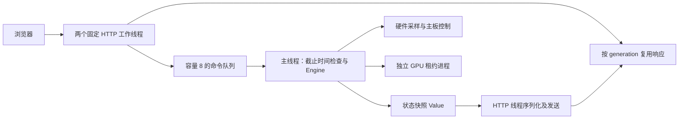

# 2026-10-21 性能与架构审查

本次覆盖控制调度、HTTP、设备发现、hwmon、NVML、独立 GPU 写入进程、配置持久化、历史/日志、前端轮询及静态资源。实施了控制器所有权重构、按版本复用响应、扫描与采样路径的分配优化，以及静态资源重验证。没有增加依赖或常驻工作线程，没有调整采样、温度保护或控制租约的频率。

已有前端优化保留。演示与模拟驱动承担所有测试控制写入；真实硬件只运行 `--benchmark` 只读采样。没有重启或改动正在控制真实风扇的已安装服务。

## 检查结果与处理

| 路径 | 发现 | 处理 |
|---|---|---|
| 控制调度 / HTTP | HTTP 与硬件控制共享 `Mutex<Engine>`；状态组装、序列化与周期争用锁 | 主线程独占 Engine；HTTP 通过容量 8 的命令队列请求快照或提交修改；每条命令前检查控制截止时间；序列化与网络发送在 HTTP 工作线程进行 |
| 重复状态读取 | 多页面/高频读取反复深拷贝、序列化相同控制周期的数据 | 在采样/修改开始及完成时失效旧 generation，并按当前 generation 缓存至多两份响应体，合计最多 256 KiB；按需生成；缓存响应使用共享字节切片，无额外 Vec 容量 |
| 缓存并发 | 较慢的请求可能晚于新周期返回 | 较旧 generation 不得回退缓存；修改失败也可能改变恢复状态，因此同样失效；编辑心跳只续发现租约，不失效状态缓存 |
| 排队修改 | 硬件繁忙时请求可能排队过久 | 队列有界；命令开始前检查 10 秒有效期，过期命令不执行；已经开始的操作不能用客户端断线撤销 |
| 健康接口 | 获取简单状态也会争用控制器 | 原子健康布尔值；静态运行方式保存在客户端；不为闲置周期生成健康 JSON |
| 控制循环配置 | 每轮深拷贝整份风扇列表及节点 | 缩短单颗风扇配置的借用，在失败恢复前只复制必要信息 |
| 扫描与启动 | 一次手动扫描实际读取三轮硬件；启动前还有额外采样 | 一次新样本先用于保护，再复用以计算新增配置输出；配置持久化之前仍先执行保护 |
| hwmon | 每轮重新分配并排序通道 ID；数值读取后再分配裁剪字符串 | 通道顺序只在发现时生成；直接解析读取缓冲区；继续每轮读取新值，不持有旧数值冒充实时数据 |
| NVML 函数入口 | 反复动态查找同一驱动符号，缺失接口也反复查找 | 每个库实例解析一次有类型的函数指针；可选接口保持可选；句柄及指针均不跨库生命周期使用 |
| NVML 故障 | policy/duty 读取失败把发现时间戳清空，下一轮会再次枚举 | 立即标记通道不可写，保留时间戳并标记失效，恢复为 30 秒发现重试；每轮仍读取当前值，手动扫描可立即重试 |
| HTTP 传输 | 每个请求复制套接字；格式化响应头可能拆成多次 socket 写入 | 缓冲读取直接借用连接；在内存组装响应头后整段发送 |
| 静态资源 | 全部 `no-store`，同页动态插入 SVG 或刷新会重复传完整资源 | HTML/CSS/JS/SVG 使用内容哈希 ETag 与 `no-cache`；匹配时 304，无响应体；错误 ETag 返回完整新内容；API 仍 `no-store` |
| GPU 写入进程 | 独立进程、逐路 10 秒租约、每次写入独立温度检查 | 保持；没有省略稳定输出的租约续期、自身温度检查或主动输出重申 |
| 文件持久化 | 仅用户修改或租约变化时原子写入并 fsync | 保持；没有以异步丢失写入或删除 fsync 换取指标 |
| 历史与日志 | 历史至多 180 条，事件至多 60 条，温度平均按时间窗口裁剪 | 保持；常规操作不积累无限状态副本 |
| 前端 | 隐藏页暂停、观看页精简、DOM 按变化更新已在上一轮实施 | 保留；观看页继续不加载编辑器、不提交设备发现心跳 |

HTTP 重验证使用内容哈希而非构建时间，代码/样式变化后会获得新 ETag。`no-cache` 允许存储但要求使用前验证；它与禁止存储的 `no-store` 不同，规则见 [RFC 9111](https://www.rfc-editor.org/rfc/rfc9111.html#section-5.2.2.4)。验证请求仍有响应头与连接开销，304 不等于零网络开销。

## 调度结构



主线程仍负责构建状态快照以及有序执行修改。它不等待浏览器读取响应，不承担 JSON 编码。没有网页访问时仅运行原有控制逻辑并更新两个原子状态值，不提前构造完整 API 响应。

该结构不把硬件接口变成可抢占任务：驱动调用、配置 fsync、GPU 进程通信等已经开始的操作仍可能阻塞。控制截止时间的优先检查防止排队请求饿死周期，不构成最坏情况 1 秒实时保证。

## 对照方法

基线是本次审查开始时、包含上一轮前端优化的工作区二进制；不是最初的 Git HEAD，也不是历史 Python 服务。具体二进制哈希保存在本地原始 JSON 中。

`tests/benchmark_runtime.py` 对同一个二进制依次运行：

1. 三路默认演示配置，8 秒无请求窗口。
2. 两个并发客户端分别对观看、完整状态、增量状态各读取 10,000 次。
3. 64 路配置、128 条 32 节点曲线，重复上述窗口和接口测试。

扩展配置中的风扇为离线配置，不对应 64 个真实设备。演示没有加载 NVIDIA 驱动库，也不包含独立 GPU 写入进程；RSS 不能当成已安装真实硬件服务的内存。

服务端 CPU 用各线程 `/proc/<pid>/task/*/schedstat` 的累计运行纳秒差值，同时保留进程 CPU tick 计数。CPU tick 在本机粒度为 10 毫秒，不适合单独解释极短闲置窗口。RSS 来自 `/proc/<pid>/status`，不是 cgroup 计费内存或 PSS。客户端 CPU 不计入服务端指标。

每项只有一个短窗口；固定请求数意味着新版本更快完成时包含的后台周期数可能不同。示例结果用于定位重复处理成本，不是长期功耗或普遍比例保证。两次运行没有锁定系统负载。

## 测量结果

| 配置 / 接口，每项 10,000 次读取 | 累计服务端 CPU：修改前 → 修改后 | 该项结束时 RSS：修改前 → 修改后 |
|---|---:|---:|
| 3 路 / 观看 | 389.9 → 177.8 ms | 3.64 → 3.50 MiB |
| 3 路 / 完整状态 | 581.1 → 159.9 ms | 3.75 → 3.58 MiB |
| 3 路 / 增量状态 | 541.2 → 166.2 ms | 3.79 → 3.59 MiB |
| 64 路 / 观看 | 4471.8 → 188.1 ms | 8.86 → 7.35 MiB |
| 64 路 / 完整状态 | 4951.7 → 260.1 ms | 8.91 → 7.61 MiB |
| 64 路 / 增量状态 | 1193.4 → 164.3 ms | 8.92 → 7.61 MiB |

64 路完整状态负载的累计服务端 CPU 约减少 94.7%，负载后 RSS 约减少 1.31 MiB；改善集中在复用序列化结果、消除重复分配和减少 socket 系统调用。所有场景都维持 4 个应用线程；演示历史中观测到的最大采样间隔，修改前约 1.002 秒，修改后约 1.001 秒。该历史可能含测量前的周期，不是硬件故障情况下的延迟上限。

| 8 秒无请求窗口 | 累计服务端 CPU：修改前 → 修改后 |
|---|---:|
| 3 路配置 | 0.723 → 1.110 ms |
| 64 路配置 | 8.176 → 4.906 ms |

三路闲置窗口的绝对差不足 1 毫秒，不能据此给出稳定的常驻 CPU 降幅。64 路配置消除配置副本后，演示闲置计算有所下降；真实后台还承担驱动访问，不能直接套用演示比例。

图标重验证从 HTTP 200、4,372 字节响应体，变成 HTTP 304、0 字节响应体。二进制从 1,262,000 增至 1,301,928 字节，约增加 39.0 KiB；新增架构代码带来少量磁盘体积增长，没有新增依赖或常驻线程。

原始数据保存在本地 `docs/performance/2026-10-21/` 的 `runtime-before.json` 与 `runtime-after.json`。该目录由 Git 忽略，不随仓库分发；仓库保留结论、测量条件和复现脚本，后续测量输出到 `test-results/`。

## 真实硬件只读追踪与剩余成本

分别对前后二进制执行 `strace -c ... --benchmark 3`。包含一次预热发现、三次采样及驱动初始化；未运行控制模式。两次追踪的 `ioctl` 分别占被追踪线程系统调用耗时的约 72% 和 76%。这是系统调用时间的分布，不是全进程 CPU 分布，更不是整机 CPU 使用率。驱动内部线程、用户态工作与 tracing 本身会影响结果，不能用这几次样本推导整服务降幅。

系统调用追踪与采样记录保存在上述本地目录的 `hardware-profile-before.txt`、`hardware-profile-after.txt`、`hardware-profile-before.json` 与 `hardware-profile-after.json`，不随仓库分发。

以下路径经检查保留，后续有对应环境的实测瓶颈再调整：

- 正常 NVML 路径不启动 `nvidia-smi`；兼容回退成功时约每 3 秒执行，失败退避 30 秒、子进程超时 2 秒。回退查询仍同步执行，慢查询可能拉长控制周期。没有为了罕见兼容路径增加常驻线程或放宽温度失效保护。
- 主板稳定输出每 3 秒重新写入，看门狗独立每 3 秒续期。NVIDIA 每次写入检查自身温度并续租。此类操作不以缓存结果替代。
- 不延长实时温度与 RPM 采样周期，不把未选中的传感器读数伪装成实时缓存，不共享父进程读数来替代 GPU 守护自身温度检查。
- 不保留 sysfs 文件描述符来规避打开/关闭；设备移除、驱动重载和 hwmon 编号复用的恢复语义更重要，当前配置下未证明此改动值得承担复杂度。
- 未引入数据库、异步运行时、通用状态框架或在线压缩。配置写入频率低，回环传输已经很小，新增设施的持续成本需要具体瓶颈证明。

## 验证与复现

通过 54 项 Rust 单元测试、19 项 Python 黑盒测试、桌面/手机浏览器回归、Clippy 与格式检查。新增覆盖包括：过期修改不执行、心跳不失效缓存、缓存容量和过期版本、手动扫描采样次数、静态 ETag、修改后状态立即失效、GPU 读数失败不逐周期枚举、驱动采样阻塞时不返回旧缓存读数。原有超温/温度缺失/停转保护、GPU 零输出自动模式、独立租约、崩溃恢复、原子保存、并发冲突和配置兼容测试继续通过。

```bash
# 备份基线二进制后，分别测量。脚本自行启动/结束临时演示实例。
python3 tests/benchmark_runtime.py --binary /path/to/before \
  --label before --output test-results/runtime-before.json
python3 tests/benchmark_runtime.py --binary target/release/fancontrollx \
  --label after --output test-results/runtime-after.json
```

这次未部署到实际控制服务。真实 cgroup CPU、内存及长期运行情况，需要用户部署后用 `tests/benchmark_service.py` 重新测量；不能把本报告的演示结果当作该数据。
